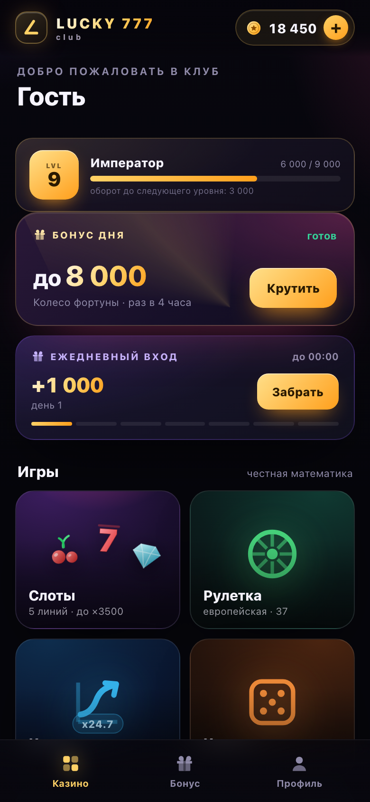
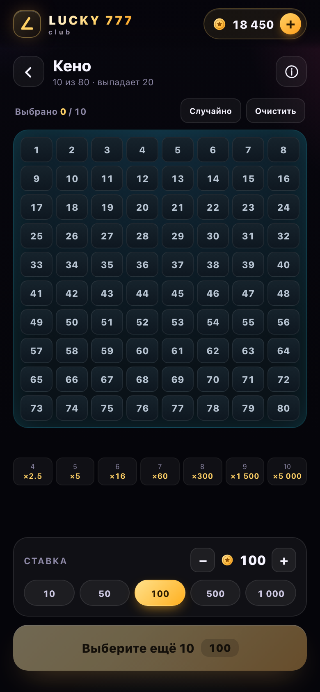
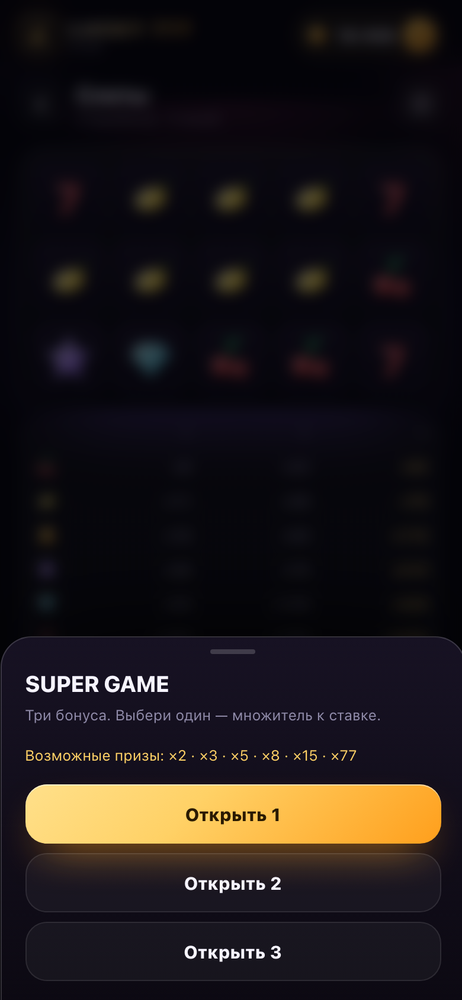
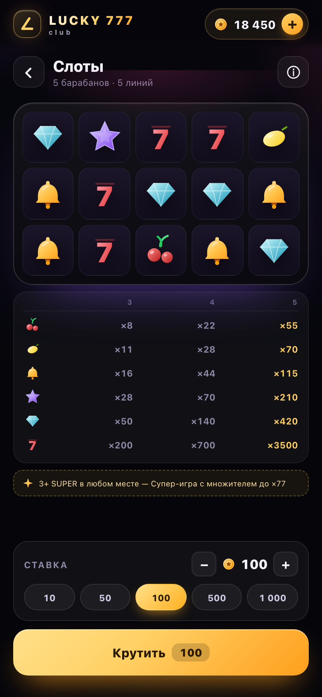
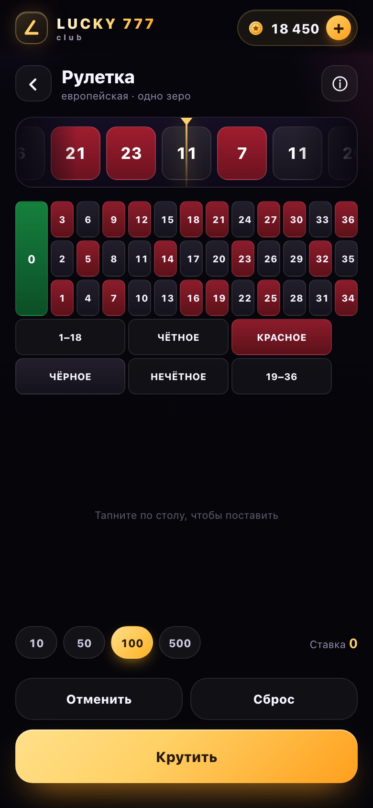
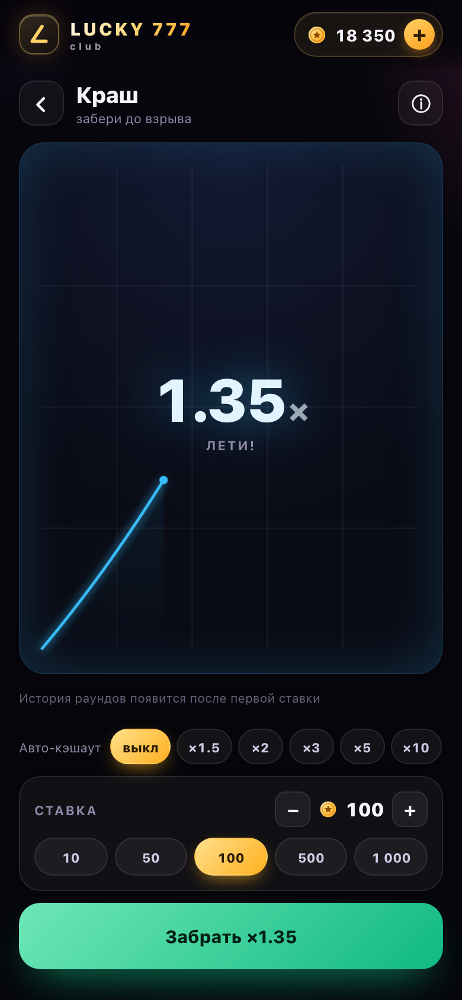
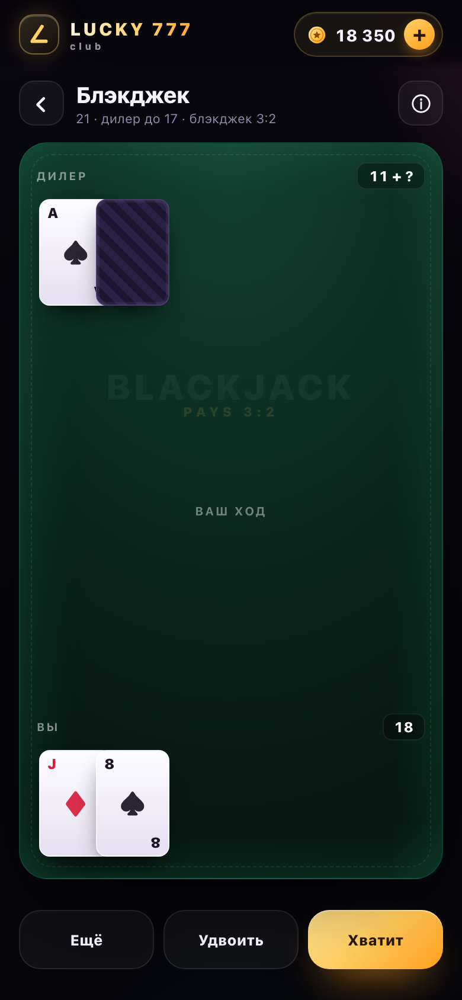
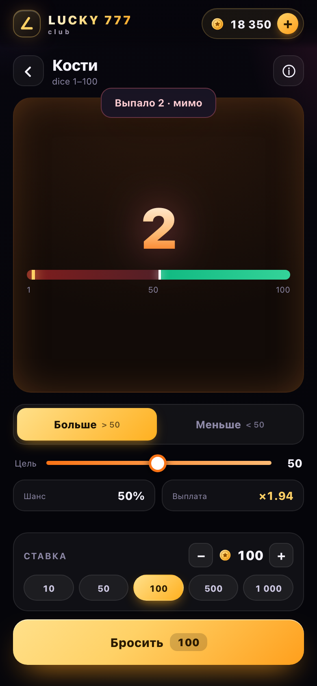
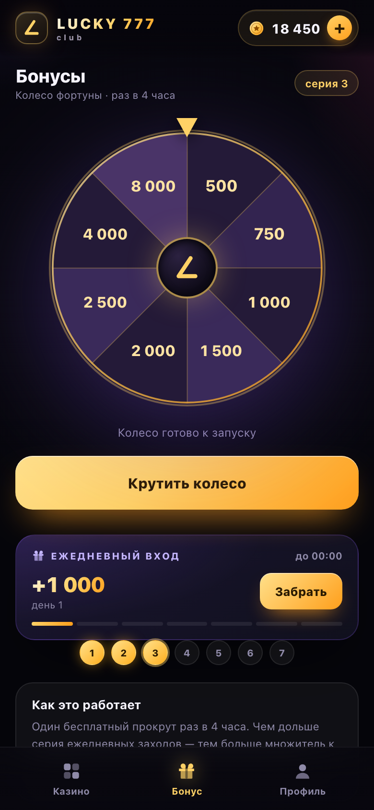

# LUCKY 777 — виртуальный клуб (Telegram Mini App)

Казино на **виртуальные очки**: шесть игр, бонус-колесо, ежедневный вход, статистика и сохранение прогресса. Денег нет, вывода нет, всё по-честному — математика как в настоящем казино, но ставки только на очки.



Кено: 

Суперигра: 

## Что внутри

| Игра | Механика | RTP |
|---|---|---|
| **Слоты** | 5×3, 5 линий, 3+ SUPER запускают суперигру | ~97% |
| **Рулетка** | европейская, 37 чисел, число, цвет, чёт и дюжины | 97,3% |
| **Блэкджек** | 21, дилер до 17, блэкджек 3:2, удвоение | ~98–99% |
| **Краш** | растущий множитель, ручной и авто-кэшаут | 97% |
| **Кости** | 1–100, больше/меньше, цель и множитель | 97% |
| **Кено** | 80 чисел, выбираешь 10, выпадает 20 | ~96% |

Плюс:

- **Колесо фортуны** — бесплатный прокрут раз в 4 часа, 500–8 000 очков, серия до +50%.
- **Ежедневный вход** — кнопка «Забрать», сброс в **00:00 по локальному времени**, 1 000–2 500 очков, серия дней.
- **Уровни** — 1 очко оборота = 1 XP, квота 1 000 × уровень. Банкротство (баланс < 10) сбрасывает на 1 уровень и даёт 1 000 очков.
- **Суперигра** — 3+ символа SUPER в слотах открывают выбор из трёх бонусов ×2…×77.
- **Прогресс** — баланс, статистика, достижения, последние раунды. Хранение: `localStorage` + Telegram CloudStorage (если доступен).
- **Telegram** — тема, haptic-отклик, BackButton, авторизация через `initDataUnsafe.user`, безопасные зоны.
- **Рефералка** — позови друга: ему +2 000 очков, тебе +1 000 после ответного бонус-сообщения. Ссылка ведёт прямо в мини-аппу.

## Уровни и суперигра

Уровень растёт от оборота: каждый поставленный 1 000 очков даёт новый уровень (квота следующего = 1 000 × уровень). При балансе меньше 10 уровень сбрасывается на 1-й, а игрок получает 1 000 очков страховки. Уровень и прогресс видны на главной и в профиле.

В слотах 3+ символа **SUPER** в любом месте запускают суперигру: три закрытых бонуса, игрок выбирает один, получает множитель к ставке (×2…×77). Шанс выпадения — около 0,25% на спин.

## Бэкенд и бот в чате

План и схема — в [SUPABASE.md](SUPABASE.md). Бот в группе и общий прогресс требуют Supabase; текущая мини-аппа работает локально.

## Рефералка

Без сервера, на Telegram-сообщениях:

1. В профиле жмёшь **«Пригласить»** → Telegram предлагает отправить другу сообщение со ссылкой
   `t.me/<бот>/<short-name>?startapp=ref_<твой-id>`.
2. Друг открывает ссылку, получает **+2 000** и кнопку **«Отправить другу бонус»**.
3. По этой кнопке тебе приходит сообщение со ссылкой `...?startapp=claim_<id>_<срок>_<код>`.
4. Ты открываешь её → **+1 000**, друг записывается в счётчик.

Ограничения: лимит 50 друзей, ссылка-бонус живёт 30 дней, повторно один друг не засчитывается. Токен клиентский — для реальных денег нужен сервер, для виртуальных очков этого достаточно.

Пока `botUsername` в `js/config.js` пустой, ссылки ведут на сайт (в браузер), а не в Telegram. После создания бота в BotFather впиши туда `botUsername` и `appShortName`.

## Запуск

Никакой сборки и зависимостей — чистые ES-модули.

```bash
python3 server.py          # http://127.0.0.1:8765
```

Файл нельзя открывать через `file://` — модули требуют HTTP.

## Проверки

```bash
# математика и RTP (быстро, без браузера)
node tools/rtp.mjs 300000

# e2e: все шесть игр, бонусы, баланс, отсутствие JS-ошибок (headless Chrome)
node tools/e2e.mjs

# рефералка: ref → +2000, claim → +1000, защита от повторов
node tools/referral.mjs

# математика дюжин и кено
node tools/features.mjs

# скриншот любого экрана
node tools/shot.mjs http://127.0.0.1:8765/#/slots shots/slots.png --seed
```

`tools/cdp.mjs` — мини-обвязка над Chrome DevTools Protocol без puppeteer. Chrome запускается с `--use-mock-keychain`, поэтому **не лезет в связку ключей macOS**.

## Деплой в Telegram

Подробная пошаговая инструкция для новичка — в [DEPLOY.md](DEPLOY.md). Ниже — короткая версия.

1. Залей папку на любой HTTPS-хостинг (GitHub Pages, Cloudflare Pages, Vercel — статикой).
2. В `@BotFather`: `/newapp` → выбери бота → укажи URL.
3. Либо поставь Menu Button: `/setmenubutton` → URL мини-аппы.
4. Готовый бот-пример — в `bot/bot.py` (aiogram 3).

```bash
cd bot
python3 -m venv .venv && . .venv/bin/activate
pip install -r requirements.txt
BOT_TOKEN=... WEBAPP_URL=https://твой-домен.example python bot.py
```

> Для Telegram нужен именно HTTPS. Локальный `http://127.0.0.1` откроется только в браузере.

## Структура

```
index.html            разметка всех экранов + SVG-спрайт
css/app.css           дизайн-система, анимации, адаптив
js/
  app.js              bootstrap, роутер, связывание экранов
  core/               store, telegram, звук, UI-компоненты, ставки, правила, дейли
  math/               чистая математика игр (общая для UI и симуляций)
  games/              контроллеры экранов: слоты, рулетка, краш, кости, блэкджек
  screens/            главная, бонусы, профиль, дейли
tools/                RTP-лаборатория, e2e, скриншоты, CDP-харнесс
bot/                  пример Telegram-бота (aiogram 3)
server.py             локальный статический сервер
```

Математика отделена от DOM: `js/math/*.js` импортируется и браузером, и Node-скриптом симуляции. Поэтому RTP можно пересчитывать без запуска приложения.

## Честность и ограничения

- Все очки — виртуальные. Их нельзя купить, обменять или вывести; приложение развлекательное, 18+.
- Генератор — `crypto.getRandomValues`, без «подкруток» под игрока.
- Прогресс хранится локально и в Telegram CloudStorage; при очистке данных начинается заново (10 000 приветственных очков).
- Сплита и страховки в блэкджеке нет — сознательное упрощение.
- RTP посчитан симуляцией (`tools/rtp.mjs`), а не взят из головы.

## Скриншоты

| Слоты | Рулетка | Краш |
|---|---|---|
|  |  |  |

| Блэкджек | Кости | Бонусы |
|---|---|---|
|  |  |  |
